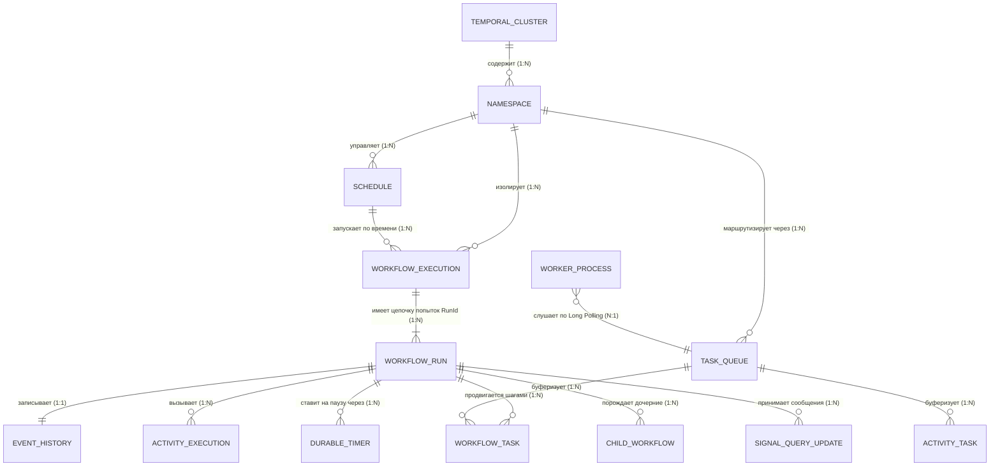
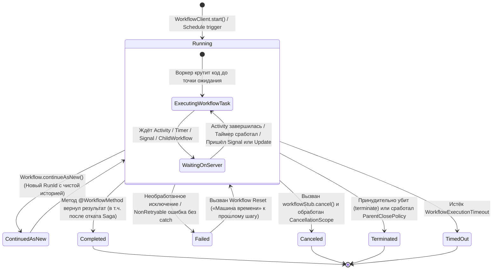

# 🗺️ Схемы сущностей Temporal: вложенность, границы и взаимозависимости

Этот документ — визуальный справочник по устройству **Temporal**. Все схемы приведены в двух видах: **текстовая блочная графика (ASCII)** (читается в любом редакторе и терминале) и **диаграммы Mermaid** (для Markdown Preview / GitHub).

---

## 1. «Матрёшка» вложенности: кто внутри кого живёт?

Логическая иерархия всех сущностей сверху вниз (от всего кластера до отдельного шага внутри сценария):

```text
╔══════════════════════════════════════════════════════════════════════════════════════╗
║ 🏛️ TEMPORAL CLUSTER (Сервер оркестрации + БД PostgreSQL / Cassandra + Elasticsearch) ║
║                                                                                      ║
║  ┌────────────────────────────────────────────────────────────────────────────────┐  ║
║  │ 📂 NAMESPACE (напр. "default") — Изолированная комната проекта                 │  ║
║  │    Хранит свои настройки ретеншна истории, квоты, Search Attributes и права    │  ║
║  │                                                                                │  ║
║  │  ├── 🗓️ SCHEDULES (Расписания)                                                │  ║
║  │  │    └── По таймеру/календарю порождают новые ──► Workflow Executions         │  ║
║  │  │                                                                             │  ║
║  │  ├── 📋 TASK QUEUE (напр. "ShowcaseTaskQueue") — Логическая шина задач         │  ║
║  │  │    ├── 🧠 Workflow Task Sub-Queue (задачи на принятие решений: ход сценария)│  ║
║  │  │    ├── 🛠️ Activity Task Sub-Queue (задачи на походы в сеть/БД)              │  ║
║  │  │    └── 📌 Sticky Queue (быстрая очередь конкретного Worker'а с кэшем в ОЗУ) │  ║
║  │  │                                                                             │  ║
║  │  └── 🎬 WORKFLOW EXECUTION (Запущенный бизнес-процесс)                         │  ║
║  │       │  Ключ уникальности в Namespace: [WorkflowId] (напр. "showcase-a1b2c3") │  ║
║  │       │                                                                        │  ║
║  │       └── 🔄 WORKFLOW RUN (Конкретная попытка выполнения: [RunId UUID])        │  ║
║  │            │  (Новый RunId создаётся при Retry всего Workflow, Reset или       │  ║
║  │            │   Continue-As-New)                                                │  ║
║  │            │                                                                   │  ║
║  │            ├── 📜 EVENT HISTORY (Неизменяемый лог событий #1..#N — Save Points)│  ║
║  │            ├── 🗂️ MUTABLE STATE + MEMO + SEARCH ATTRIBUTES (Состояние и теги) │  ║
║  │            │                                                                   │  ║
║  │            ├── 📡 КАНАЛЫ ВНЕШНЕГО ВЗАИМОДЕЙСТВИЯ (Message Passing):            │  ║
║  │            │    ├── 🔔 Signal (@SignalMethod)  — Вход (async, меняет стейт)    │  ║
║  │            │    ├── 🔍 Query  (@QueryMethod)   — Выход (sync, только чтение)   │  ║
║  │            │    └── 🔄 Update (@UpdateMethod)  — Вход+Выход (sync + валидатор) │  ║
║  │            │                                                                   │  ║
║  │            └── 🧩 ВНУТРЕННИЕ ПРИМИТИВЫ И ПОРОЖДАЕМЫЕ ШАГИ:                     │  ║
║  │                 ├── ⏰ Durable Timer (Workflow.sleep / await — будильник в БД) │  ║
║  │                 ├── ⚡ Local Activity (выполняется в памяти Worker'а)          │  ║
║  │                 ├── 🛠️ Activity Execution (внешний шаг с RetryOptions)         │  ║
║  │                 │    ├── 💓 Heartbeat & Checkpoint (пульс и прогресс шага)     │  ║
║  │                 │    └── 🎟️ TaskToken (для внешнего Async Activity Completion) │  ║
║  │                 ├── 🛡️ CancellationScope (коробка для групповой отмены задач)  │  ║
║  │                 ├── ⏪ Saga (стек компенсирующих действий LIFO)                │  ║
║  │                 └── 👶 Child Workflow Execution (дочерний процесс со своим     │  ║
║  │                        собственным WorkflowId, RunId и Event History!)         │  ║
║  └────────────────────────────────────────────────────────────────────────────────┘  ║
╚══════════════════════════════════════════════════════════════════════════════════════╝
```

---

## 2. Физические границы: где живёт каждая сущность?

Самая частая путаница у новичков: **что находится на сервере Temporal, а что — внутри нашего Spring Boot приложения?**

```text
+-----------------------------------------------------------------------------------+
| 🌐 1. КЛИЕНТ (REST Controller / Внешний сервис / CLI / UI)                        |
|                                                                                   |
|   Использует: WorkflowClient / ScheduleClient / ActivityCompletionClient          |
|   Делает:     • Запускает Workflow (start / execute)                              |
|               • Шлёт Signals, Queries, Updates                                    |
|               • Завершает внешние Activity по TaskToken                           |
+-----------------------------------------+-----------------------------------------+
                                          |
                                          | gRPC (порт 7233)
                                          v
+-----------------------------------------------------------------------------------+
| 🏛️ 2. TEMPORAL SERVER + БАЗА ДАННЫХ (Docker: temporal + postgresql)               |
|                                                                                   |
|   ❗ НЕ СОДЕРЖИТ И НЕ ВЫПОЛНЯЕТ ВАШ JAVA-КОД!                                     |
|                                                                                   |
|   Хранит в БД:               Управляет в памяти:                                  |
|   • Namespaces               • Task Queues (Matching Service)                     |
|   • Event History (#1..#N)   • Серверными таймерами (Timer Queue)                 |
|   • Mutable State            • Расписаниями (Schedules)                           |
|   • Search Attributes        • Политиками ретраев (Retry Backoff Timer)           |
+--------------------+-----------------------------------------+--------------------+
                     ^                                         ^
                     | gRPC Long Polling                       | gRPC Long Polling
                     | (Очередь Workflow Tasks)                | (Очередь Activity Tasks)
                     v                                         v
+-----------------------------------------------------------------------------------+
| 👷 3. WORKER PROCESS (Наше Spring Boot приложение на порту 8081)                  |
|                                                                                   |
|   Здесь живёт весь ваш бизнес-код:                                                |
|   ┌────────────────────────────────────┐   ┌────────────────────────────────────┐ |
|   │ 🧠 Workflow Worker                 │   │ 🛠️ Activity Worker                 │ |
|   │  • Крутит @WorkflowImpl            │   │  • Крутит @ActivityImpl            │ |
|   │  • Выполняет Replay по истории     │   │  • Ходит в БД, HTTP, брокеры       │ |
|   │  • Вызывает Local Activities       │   │  • Шлёт Heartbeat(progress)        │ |
|   │  • Считает Saga и CancellationScope│   │  • Генерирует TaskToken            │ |
|   └────────────────────────────────────┘   └────────────────────────────────────┘ |
+-----------------------------------------------------------------------------------+
```

---

## 3. Граф взаимозависимостей и кардинальность связей (ER-схема)

Как сущности соотносятся друг с другом количественно (`1:1`, `1:N`, `N:M`):



### Таблица зависимостей: кто от кого зависит?

| Сущность | От чего зависит (Родитель / Контекст) | Кого порождает или кем управляет | Кратность |
| :--- | :--- | :--- | :--- |
| **`Namespace`** | `Temporal Cluster` | Содержит `Workflow Executions`, `Task Queues`, `Schedules` | `1 Cluster` $\rightarrow$ `N Namespaces` |
| **`Task Queue`** | `Namespace` (создаётся на лету по имени строки) | Раздаёт `Workflow Tasks` и `Activity Tasks` подключённым `Workers` | `1 Queue` $\leftrightarrow$ `N Workers` |
| **`Worker`** | Слушает ровно 1 `Task Queue` (в процессе может быть несколько воркеров на разные очереди) | Регистрирует классы `@WorkflowImpl` и бины `@ActivityImpl` | `N Workers` $\rightarrow$ `1 Task Queue` |
| **`Workflow Execution`** | `Namespace` + привязан к `Task Queue` | Состоит из одного или нескольких последовательных `Workflow Runs` (`RunId`) | `1 WorkflowId` $\rightarrow$ `N RunIds` (во времени) |
| **`Workflow Run`** | `Workflow Execution` | Имеет ровно 1 `Event History`; порождает `Activities`, `Timers`, `Child Workflows` | `1 RunId` $\rightarrow$ `1 Event History` |
| **`Activity Execution`** | Вызывается из `Workflow Run` через `ActivityStub` | Может состоять из `1..M` попыток (`Attempt`) согласно `RetryOptions` | `1 Activity` $\rightarrow$ `M Attempts` |
| **`Child Workflow`** | Порождается родительским `Workflow Run` | Сам является полноценным `Workflow Execution` (зависит от родителя через `ParentClosePolicy`) | `1 Parent` $\rightarrow$ `N Children` |
| **`Saga`** | Локальный объект внутри кода `Workflow Run` | Накапливает стек компенсирующих `Activities` и запускает их в обратном порядке (`LIFO`) | `1 Saga` $\rightarrow$ `N Compensations` |

---

## 4. Как связаны Workflow, Task Queue, Worker и Activity в работе?

Ниже показано, как **один шаг кода** превращается в цепочку задач между Сервером и Воркером:

```text
  [Код в ShowcaseWorkflowImpl]
  String res = standardActivities.callFlakyExternalService("Payment", 2);
         │
         ▼
  1. Workflow Worker доходит до этой строки и говорит Серверу:
     "Запланируй Activity 'callFlakyExternalService' в очереди 'ShowcaseTaskQueue'!"
         │
         ▼
  2. Temporal Server:
     • Пишет в Event History: [ActivityTaskScheduled]
     • Кладёт задачу в подочередь [Activity Task Queue]
         │
         ▼
  3. Activity Worker забирает задачу из очереди и запускает метод Java:
     • Попытка #1 -> ОШИБКА! (Сервер ждёт 1 сек по RetryOptions и возвращает задачу в очередь)
     • Попытка #2 -> ОШИБКА! (Сервер ждёт 1.5 сек и возвращает задачу в очередь)
     • Попытка #3 -> УСПЕХ! Возвращает строку "Успешно выполнено с попытки #3"
         │
         ▼
  4. Temporal Server:
     • Пишет в Event History: [ActivityTaskCompleted (result = "Успешно...")]
     • Кладёт новую задачу в подочередь [Workflow Task Queue]: "Разбуди Workflow!"
         │
         ▼
  5. Workflow Worker берёт Workflow Task, подставляет результат в переменную `res`
     и переходит к следующей строчке кода!
```

### Отличие обычной `Activity` от `Local Activity`:

```text
Обычная Activity:
Workflow Worker ──► Temporal Server (БД + Task Queue) ──► Activity Worker (любой хост)
(Полная изоляция, долгие ретраи, распределение нагрузки, но +10..30 мс на сеть/БД)

Local Activity:
Workflow Worker ──► Прямой вызов в памяти того же JVM-процесса ──► Запись итога в History
(Задержка < 1 мс, не нагружает очередь Matching Service, для быстрых коротких шагов)
```

---

## 5. Диаграмма состояний (Жизненный цикл `Workflow Execution`)

В каких состояниях может находиться процесс и что переводит его из одного состояния в другое:



---

## 6. Как все эти сущности представлены в нашем проекте (`temporal-spring-demo`)

Схема соответствия абстрактных сущностей Temporal реальным файлам вашего репозитория:

```text
📂 Namespace: "default" (настроен в src/main/resources/application.yml)
 │
 ├── 📋 Task Queue: "OrderTaskQueue" (Базовый пример)
 │    ├── 🎬 Workflow:  OrderWorkflow / OrderWorkflowImpl
 │    ├── 🛠️ Activity:  OrderActivity / OrderActivityImpl
 │    └── 🌐 Клиент:    OrderController (/api/orders/*)
 │
 └── 📋 Task Queue: "ShowcaseTaskQueue" (Полная песочница возможностей)
      │
      ├── 🎬 Главный Workflow: ShowcaseWorkflow / ShowcaseWorkflowImpl
      │    ├── 🔀 Versioning:         Workflow.getVersion("showcase-flow-v1", ...)
      │    ├── ⚡ Local Activity:     localActivities.fastLocalCheck(...)
      │    ├── ⏰ Timer + Await:      Workflow.await(Duration, () -> approvedBySignal)
      │    ├── 🔔 Signal Handler:     @SignalMethod approveSignal(approverName)
      │    ├── 🔍 Query Handler:      @QueryMethod getState() -> ShowcaseState
      │    ├── 🔄 Update + Validator: @UpdateMethod adjustBudgetUpdate(delta)
      │    │                          @UpdateValidatorMethod validateBudgetUpdate(delta)
      │    ├── 🏁 Параллельная гонка: Async.function + Promise.anyOf + CancellationScope
      │    ├── 👶 Child Workflow:     DeliveryChildWorkflow / DeliveryChildWorkflowImpl
      │    └── ⏪ Транзакция Saga:    new Saga(...) + addCompensation(...) + compensate()
      │
      ├── 🛠️ Исполнитель Activity: ShowcaseActivity / ShowcaseActivityImpl
      │    ├── 💥 Ретраи и ошибки:    callFlakyExternalService (ApplicationFailure)
      │    ├── 💓 Пульс и чекпоинт:   runHeavyTaskWithHeartbeat (ctx.heartbeat / getHeartbeatDetails)
      │    ├── 🎟️ Внешний TaskToken:  waitForExternalCallback (ctx.doNotCompleteOnReturn + AsyncTokenRegistry)
      │    └── 📦 Шаги и откат Saga:  sagaReserveInventory / sagaCompensateInventory и др.
      │
      └── 🌐 Клиент и управление: ShowcaseController (/api/showcase/*)
           ├── 🚀 Запуск сценариев:   WorkflowClient.start(...) / синхронный вызов стаба
           ├── 🎟️ Внешний колбэк:     ActivityCompletionClient.complete(taskToken, result)
           └── 🗓️ Расписания:         ScheduleClient.createSchedule(...) / handle.delete()
```
