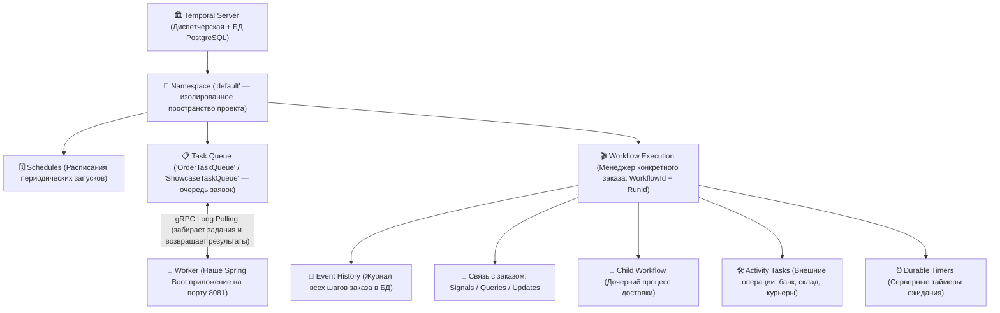
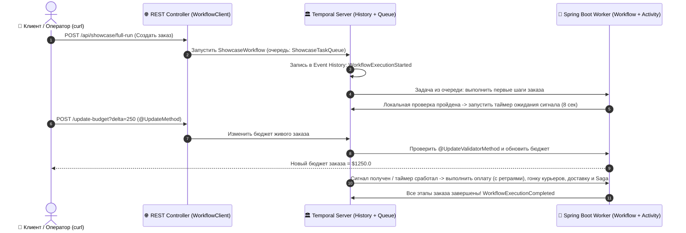

# ⏳ Temporal от А до Я: руководство и демо-песочница на сквозном примере заказа

Это руководство объясняет работу **Temporal** на **одном сквозном, жизненном примере — обработке и доставке заказа в интернет-магазине**, без смешения разных метафор, с примерами кода на **Java 25 + Spring Boot 4** и ссылками на официальную документацию.

---

## 1. Что такое Temporal и какую проблему он решает?

> **Официальное определение:**
> **Temporal** — это open-source платформа для **надёжного выполнения кода (Durable Execution Platform)** и **оркестрации распределённых бизнес-процессов (Workflow Orchestration Engine)**, которая гарантирует, что ваш код дойдёт до конца без потери состояния даже при сбоях серверов, сети и внешних сервисов.
>
> **Техническое определение:**
> Это распределённый движок конечных автоматов (state machine engine) на базе **Event Sourcing**, который берёт на себя хранение состояния процесса, таймеры, очереди задач, ретраи и восстановление после сбоев, позволяя писать многошаговые асинхронные процессы как обычный последовательный код.

### Сквозной пример: Заказ №777 в интернет-магазине

Представь обычный процесс обработки заказа в интернет-магазине:
1. **Проверить параметры заказа** и зарезервировать бюджет.
2. **Подождать подтверждения** от клиента или оператора (например, до 8 секунд / 24 часов).
3. **Списать деньги** через внешний платёжный шлюз банка.
4. **Опросить 3 курьерские службы** параллельно и выбрать самую быструю.
5. **Запустить процесс отгрузки и доставки** с отслеживанием контрольных точек маршрута.
6. **Оформить распределённую сделку** (бронь склада $\rightarrow$ списание средств $\rightarrow$ вызов курьера) с автоматическим возвратом денег и снятием брони, если в последний момент не оказалось свободных курьеров.

#### Что происходит в обычной программе при сбое?
Если на шаге №4 (после того как деньги с карты уже списаны!) сервер с вашим Spring Boot приложением перезагрузился или моргнула сеть:
* Обычная программа **теряет всё состояние в оперативной памяти**: локальные переменные стёрлись, таймеры пропали.
* Если просто запустить метод заказа заново с первой строчки — программа **спишет деньги с клиента второй раз**.

#### Как это решает Temporal?
**Temporal превращает каждый шаг заказа в нестираемую запись в базе данных (`Event History` — журнал событий заказа).**

Если сервер вашего приложения упадёт на полпути и перезапустится:
1. Temporal заново запустит метод обработки заказа №777 с первой строчки (этот механизм называется **Replay — воспроизведение по журналу**).
2. На каждом шаге Temporal сверяется с журналом `Event History` в БД:
   * *«Деньги по заказу №777 уже списывали? Да, в журнале записан успешный ответ банка — второй раз в банк НЕ идём, мгновенно подставляем сохранённый результат!»*
   * *«Курьерскую службу уже выбрали? Да, победила FastExpress — берём ответ из журнала!»*
3. За доли миллисекунды программа восстанавливает состояние всех переменных и продолжает реальную работу **ровно с того шага, на котором прервалась**.

* 📖 [Документация: What is Temporal & Durable Execution](https://docs.temporal.io/evaluate/understanding-temporal)

---

## 2. Все сущности Temporal на примере системы заказов

Чтобы не путаться, давай закрепим **одну единую картину мира — логистический центр интернет-магазина**:

| Сущность Temporal | Роль в системе заказов | Что делает в коде |
| :--- | :--- | :--- |
| **Temporal Server + Event History** | **Центральная диспетчерская и Журнал заказов (БД)** | Хранит историю каждого шага заказа, следит за таймерами и раздаёт задачи в очереди. |
| **Workflow** | **Менеджер-координатор конкретного заказа (например, Заказа №777)** | Описывает последовательность шагов заказа и хранит его состояние (статус, бюджет). Сам во внешние сервисы не ходит — только отдаёт поручения. |
| **Activity** | **Разовая внешняя операция** (звонок в банк, бронь склада, отправка email) | Выполняет реальный сетевой запрос или работу с БД, которая может временно упасть из-за сети. |
| **ActivityOptions + RetryOptions** | **Регламент выполнения операции** | Задаёт таймаут одной попытки (например, 30 сек) и правила автоповторов при сбое банка (до 5 попыток с паузой 1с $\rightarrow$ 2с $\rightarrow$ 4с). |
| **Task Queue** | **Лента (очередь) заявок на выполнение** | Именованная очередь (например, `"OrderTaskQueue"`), куда диспетчерская кладёт задачи, а свободные серверы-исполнители их забирают. |
| **Worker** | **Сервер-исполнитель на смене** (наше Spring Boot приложение) | Забирает задачи из очереди `Task Queue` и выполняет Java-код `Workflow` и `Activity`. |

Разберём каждую деталь подробнее.

---

### 📋 1. Workflow (Менеджер-координатор конкретного заказа)

* **Роль в примере:** Когда клиент оформляет заказ №777, для него выделяется персональный менеджер-координатор (`OrderWorkflowImpl` или `ShowcaseWorkflowImpl`) с чек-листом шагов. Менеджер сидит в изолированном кабинете: сам он на склад не ходит и в банк не звонит — он только сверяется с чек-листом, принимает решения (*«если оплата не прошла — отменяем заказ»*) и раздаёт поручения исполнителям (`Activity`).
* **Как создаётся в коде:**
  Интерфейс с `@WorkflowInterface` и реализация с `@WorkflowImpl`:
  ```java
  @WorkflowInterface
  public interface OrderWorkflow {
      @WorkflowMethod
      OrderResponse processOrder(OrderRequest request); // Старт обработки заказа
  }

  @WorkflowImpl(taskQueues = "OrderTaskQueue")
  public class OrderWorkflowImpl implements OrderWorkflow { ... }
  ```
* **Главное правило Workflow — Детерминизм:**
  Поскольку при восстановлении после сбоя Temporal заново «проигрывает» код менеджера по журналу (`Replay`), при повторном чтении тех же шагов менеджер обязан принимать **те же самые решения**.
  * ❌ **Нельзя внутри Workflow:** напрямую делать HTTP-запросы, ходить в БД, вызывать `Thread.sleep()`, `System.currentTimeMillis()`, `Math.random()`.
  * ✅ **Нужно использовать команды Temporal:** вызывать `Activity` для любых внешних операций, `Workflow.sleep()` для пауз, `Workflow.currentTimeMillis()` для текущего времени.
* **Уникальность заказа:**
  У каждого запущенного процесса есть **`WorkflowId`** (например, `"order-777"` — второй процесс с тем же номером заказа параллельно не запустится) и системный **`RunId`** (уникальный ID конкретного запуска).
* 📖 [Документация: Workflows](https://docs.temporal.io/workflows)

---

### 🛠️ 2. Activity и `ActivityOptions` (Внешние операции и их регламент)

* **Роль в примере:** Если `Workflow` — это координатор с чек-листом, то **`Activity` — это конкретная разовая операция во внешнем мире**: списать деньги в платёжном шлюзе банка, зарезервировать товар на складе, отправить письмо клиенту. Внешний мир ненадёжен: банк может не ответить с первого раза, а сеть — моргнуть.
* **Как создаётся в коде:**
  Интерфейс с `@ActivityInterface` и обычный Spring-компонент (`@Component`) с `@ActivityImpl`:
  ```java
  @ActivityInterface
  public interface OrderActivity {
      @ActivityMethod
      boolean processPayment(String orderId, double amount);
  }

  @Component
  @ActivityImpl(taskQueues = "OrderTaskQueue")
  public class OrderActivityImpl implements OrderActivity { ... }
  ```
* **Зачем нужны `ActivityOptions` и `RetryOptions`:**
  Внутри `Workflow` мы не вызываем `new OrderActivityImpl()` напрямую. Вместо этого мы создаём прокси-клиент (`ActivityStub`) и передаём ему **`ActivityOptions` — регламент выполнения поручения**:
  ```java
  OrderActivity activities = Workflow.newActivityStub(
      OrderActivity.class,
      ActivityOptions.newBuilder()
          .setStartToCloseTimeout(Duration.ofSeconds(30)) // Макс. время на 1 попытку запроса в банк
          .setHeartbeatTimeout(Duration.ofSeconds(5))     // (Опционально) Макс. пауза между отметками прогресса
          .setRetryOptions(RetryOptions.newBuilder()
              .setInitialInterval(Duration.ofSeconds(1))  // Подождать 1 сек после 1-го сбоя
              .setBackoffCoefficient(2.0)                 // Удваивать паузу при новых сбоях (1с -> 2с -> 4с...)
              .setMaximumInterval(Duration.ofSeconds(10)) // Но не ждать между попытками дольше 10 сек
              .setMaximumAttempts(5)                      // Сделать максимум 5 попыток
              .build())
          .build()
  );
  ```
* **Какие возможности это даёт:**
  * **Автоматические повторы (Retries):** Если платёжный шлюз упал с ошибкой сети на 1-й и 2-й попытке, Temporal Server сам выждет паузу и вызовет `Activity` в 3-й раз. Код `Workflow` даже не заметит сбоя и получит готовый ответ.
  * **Неповторяемые бизнес-ошибки (`NonRetryable`):** Если ошибка логическая (например, карта заблокирована навсегда — повторять запрос ещё 5 раз бессмысленно), `Activity` выбрасывает `ApplicationFailure.newNonRetryableFailure(...)`, и повторы мгновенно прекращаются.
  * **Local Activity (`LocalActivityOptions`):** Быстрая проверка (`Workflow.newLocalActivityStub`), которая выполняется прямо в памяти того же воркера за миллисекунды без постановки задачи в общую очередь сервера.
* 📖 [Документация: Activities & Timeouts](https://docs.temporal.io/activities)

---

### 👷 3. Worker и Task Queue (Сервер-исполнитель и Очередь заявок)

* **Роль в примере:**
  * **Temporal Server (Центральная диспетчерская)** сам **не выполняет ваш Java-код** и ничего не знает о том, как именно ваш магазин ходит в банк. Диспетчерская только ведёт журнал `Event History` и выкладывает задания в именованную очередь — **`Task Queue`** (например, `"OrderTaskQueue"` или `"ShowcaseTaskQueue"`).
  * **Worker (Сервер-исполнитель — наше Spring Boot приложение)** подключается к диспетчерской, следит за своей очередью `Task Queue`, забирает задания, выполняет методы `Workflow` / `Activity` и возвращает результат обратно в диспетчерскую.
* **Как настраивается в проекте:**
  В нашем приложении воркеры поднимаются автоматически при старте благодаря `temporal-spring-boot-starter` и настройке в [`application.yml`](file:///home/marhino/Projects/temporal/src/main/resources/application.yml):
  ```yaml
  spring:
    temporal:
      workers-auto-discovery:
        packages:
          - com.example.temporal
  ```
* **Масштабирование и отказоустойчивость:**
  Можно запустить 1, 5 или 50 копий Spring Boot приложения на разных серверах — все они будут параллельно разбирать заказы из одной очереди. Если один сервер выключится, его задачи подхватят остальные.
* 📖 [Документация: Workers & Task Queues](https://docs.temporal.io/workers)

---

### 📡 4. Signals, Queries и Updates (Связь клиента и оператора с живым заказом)

Пока заказ находится в обработке (например, ждёт подтверждения или комплектации), с его живым процессом `Workflow` можно взаимодействовать тремя способами:

| Механизм | Аннотация | Что это значит в примере заказа | Меняет состояние заказа? | Возвращает ответ клиенту? |
| :--- | :--- | :--- | :---: | :---: |
| **Query** (Запрос) | `@QueryMethod` | **Проверить статус заказа на сайте.** Мы просто читаем текущий этап, бюджет и лог заказа, никак не вмешиваясь в его ход. Работает даже после завершения заказа. | ❌ Нет (только чтение) | ✅ Да |
| **Signal** (Сигнал) | `@SignalMethod` | **Нажать кнопку «Подтверждаю заказ».** Уведомление отправляется в один конец (асинхронно): отправитель не ждёт ответа, а заказ внутри себя переключает флаг подтверждения и продолжает работу. | ✅ Да | ❌ Нет (`void`) |
| **Update** (Обновление) | `@UpdateMethod` + `@UpdateValidatorMethod` | **Изменить бюджет заказа на ходу с проверкой.** Синхронный запрос: сначала валидатор проверяет, не уйдёт ли бюджет заказа в минус. Если всё ок — меняет сумму и сразу возвращает новый баланс; если сумма некорректна — отклоняет запрос с ошибкой. | ✅ Да | ✅ Да (или ошибку валидации) |

* 📖 [Документация: Workflow Message Passing (Signals, Queries, Updates)](https://docs.temporal.io/encyclopedia/workflow-message-passing)

---

### ⏰ 5. Durable Timers и `Workflow.await` (Неубиваемые таймеры ожидания)

* **Роль в примере:** Допустим, после создания заказа мы даём оператору или клиенту **8 секунд** (а в реальной жизни — например, **3 дня**), чтобы прислать сигнал подтверждения или скорректировать бюджет.
* **Почему нельзя использовать `Thread.sleep()`?**
  Обычный `Thread.sleep()` блокирует поток сервера и сбрасывается при любой перезагрузке. А `Workflow.sleep(...)` и `Workflow.await(...)` сохраняют таймер в базе данных Temporal Server: поток приложения вообще не блокируется, и даже если все серверы выключить и включить к моменту окончания срока — таймер сработает вовремя.
* **Как выглядит в коде:**
  ```java
  // Ждём до 8 секунд, пока не придёт сигнал (approvedBySignal == true).
  // Если сигнал пришёл раньше — просыпаемся мгновенно! Если не пришёл за 8 сек — идём дальше по таймауту.
  boolean receivedInTime = Workflow.await(Duration.ofSeconds(8), () -> approvedBySignal);
  ```
* 📖 [Документация: Durable Timers](https://docs.temporal.io/develop/java/timers)

---

### ⚡ 6. Параллельность (`Async`), Гонка (`Promise.anyOf`) и `CancellationScope`

* **Роль в примере:** Нам нужно выбрать самую быструю службу доставки для заказа. Мы **одновременно (параллельно)** отправляем запрос расчёта доставки в 3 компании: `FastExpress` (отвечает за 700 мс), `CityPost` (1800 мс) и `SlowCargo` (3000 мс). Как только первая служба (`FastExpress`) присылает ответ, мы выбираем её победителем, а два оставшихся медленных запроса **немедленно отменяем**, чтобы не ждать их и не тратить ресурсы.
* **Как создаётся в коде:**
  * `Async.function(...)` — запускает вызов `Activity` асинхронно (параллельно).
  * `Promise.anyOf(...)` — дожидается первого завершившегося ответа (а `Promise.allOf(...)` ждёт завершения всех).
  * `CancellationScope` — объединяет запущенные задачи в группу, которую можно отменить одной командой `raceScope.cancel(...)`.
* 📖 [Документация: Cancellation Scopes & Async Execution](https://docs.temporal.io/develop/java/cancellation)

---

### 👶 7. Child Workflow (Дочерний процесс отгрузки и доставки)

* **Роль в примере:** Когда заказ переходит к этапу физической доставки по маршруту, главный менеджер заказа запускает отдельный подпроцесс — [`DeliveryChildWorkflow`](file:///home/marhino/Projects/temporal/src/main/java/com/example/temporal/showcase/workflow/DeliveryChildWorkflowImpl.java) (с номером `<workflowId>-child-delivery`).
* **Зачем выделять доставку в `Child Workflow`:**
  1. У дочернего процесса свой собственный журнал `Event History` — детальные шаги отгрузки не раздувают историю главного заказа.
  2. Можно задать правило `ParentClosePolicy.PARENT_CLOSE_POLICY_TERMINATE`: если главный заказ принудительно отменён, дочерний процесс доставки автоматически остановится вслед за ним (либо наоборот — продолжит жить самостоятельно при `ABANDON`).
* 📖 [Документация: Child Workflows](https://docs.temporal.io/develop/java/child-workflows)

---

### 💓 8. Activity Heartbeats и Checkpoints (Отметки курьера на контрольных точках)

* **Роль в примере:** Доставка заказа состоит из нескольких долгих этапов (контрольных точек маршрута: `шаг 1/4`, `2/4`, `3/4`, `4/4`). На каждом этапе исполнитель вызывает `ctx.heartbeat(step)`:
  1. **Сигнал «Я на связи» (Heartbeat):** В `ActivityOptions` задан `HeartbeatTimeout = 5 сек`. Если сервер-исполнитель зависнет и не пришлёт отметку за 5 секунд, Temporal не будет ждать минутного таймаута всей задачи, а сразу передаст доставку другому свободному воркеру.
  2. **Сохранение контрольной точки (Checkpoint):** Вместе с пульсом передаётся номер пройденного этапа (`step`). Если на 3-м этапе сервер перезагрузился, новый воркер прочитает `ctx.getHeartbeatDetails(Integer.class)` и продолжит доставку сразу с 3-го этапа, не начиная маршрут с нуля.
* 📖 [Документация: Activity Heartbeats](https://docs.temporal.io/evaluate/understanding-temporal#activity-heartbeats)

---

### 🎟️ 9. Async Activity Completion (Ожидание внешней системы по номеру накладной `TaskToken`)

* **Роль в примере:** На одном из этапов заказ передаётся во внешнюю партнёрскую систему (например, таможенное оформление или внешняя курьерская служба), которая пришлёт ответ через неопределённое время по HTTP-вебхуку. Держать рабочий поток приложения заблокированным всё это время нельзя.
* **Как работает в коде:**
  1. Внутри `Activity` мы получаем уникальный токен задачи («номер накладной») — `byte[] taskToken = ctx.getTaskToken()`, сохраняем его и вызываем `ctx.doNotCompleteOnReturn()`. Метод тут же завершается, освобождая поток воркера, но для Temporal этот шаг заказа остаётся в статусе «Выполняется».
  2. Когда внешняя система присылает HTTP-колбэк, контроллер достаёт сохранённый `taskToken` и вызывает `ActivityCompletionClient.complete(taskToken, result)` — шаг засчитывается, и заказ продолжает движение.
* 📖 [Документация: Asynchronous Activity Completion](https://docs.temporal.io/develop/java/asynchronous-activity-completion)

---

### ⏪ 10. Паттерн SAGA (Автоматический возврат средств и снятие брони при сбое)

* **Роль в примере:** Финальное оформление заказа состоит из 3 шагов в разных системах:
  1. Зарезервировать товар на складе (`sagaReserveInventory`).
  2. Списать деньги с карты покупателя (`sagaChargePayment`).
  3. Назначить курьера для выезда (`sagaDispatchCourier`).
  Если на 3-м шаге выясняется, что свободных курьеров нет (ошибка!), нельзя оставлять клиента без денег и со зависшей бронью на складе.
* **Как работает `Saga` в Temporal:**
  После каждого успешного шага мы регистрируем компенсирующее действие (`saga.addCompensation(...)`). При ошибке на 3-м шаге вызов `saga.compensate()` автоматически выполняет возвраты **строго в обратном порядке (LIFO)**:
  1. Сначала возвращает списанные деньги клиенту (`sagaRefundPayment`).
  2. Затем снимает резерв товара на складе (`sagaCompensateInventory`).
* 📖 [Документация: Saga Pattern in Temporal](https://learn.temporal.io/tutorials/java/saga/)

---

### 🗓️ 11. Schedules и Versioning (Инструменты для продакшена)

* **Schedules (Расписания):** Серверный планировщик (`ScheduleClient`), который автоматически запускает обработку регулярных заказов (например, подписку или сверку) каждые $N$ секунд/часов с защитой от наложения запусков (`Overlap Policy: SKIP`).
  * 📖 [Документация: Schedules](https://docs.temporal.io/develop/java/schedules)
* **Versioning (`Workflow.getVersion`):** Позволяет безопасно обновлять логику `Workflow` на живом сервере: заказы, запущенные до обновления, дойдут до конца по старой ветке кода, а новые — по новой, без ошибок детерминизма при `Replay`.
  * 📖 [Документация: Versioning](https://docs.temporal.io/develop/java/versioning)

---

## 3. Архитектура и взаимодействие компонентов

### Иерархия сущностей



### Пошаговая диаграмма обработки заказа

Обрати внимание: **REST-контроллер (`WorkflowClient`)** и **Worker** не вызывают друг друга напрямую — вся координация идёт через **Temporal Server** и очередь **Task Queue**:



---

## 4. Как устроен код проекта (`temporal-spring-demo`)

В проекте два пакета — от простого к полному:
1. **Базовый двухшаговый заказ (`com.example.temporal.workflow`)** — минимальный пример для быстрого старта: списание оплаты + отправка email ([`OrderWorkflowImpl.java`](file:///home/marhino/Projects/temporal/src/main/java/com/example/temporal/workflow/OrderWorkflowImpl.java)).
2. **Полный конвейер заказа со всеми примитивами (`com.example.temporal.showcase`)** — расширенный сценарий заказа ([`ShowcaseWorkflowImpl.java`](file:///home/marhino/Projects/temporal/src/main/java/com/example/temporal/showcase/workflow/ShowcaseWorkflowImpl.java)), где последовательно задействованы все возможности Temporal.

### Инфраструктура ([`docker-compose.yml`](file:///home/marhino/Projects/temporal/docker-compose.yml))
* **PostgreSQL (`:5432`)** — хранит журнал событий `Event History` всех заказов.
* **Temporal Server (`:7233`)** — центральный сервер оркестрации (gRPC).
* **Temporal Web UI (`http://localhost:8080`)** — веб-интерфейс для просмотра хода каждого заказа, его таймеров, ретраев и истории событий.
* **Spring Boot Приложение (`http://localhost:8081`)** — наш REST API + Worker.

---

### Карта этапов полного сценария заказа ([`ShowcaseWorkflowImpl`](file:///home/marhino/Projects/temporal/src/main/java/com/example/temporal/showcase/workflow/ShowcaseWorkflowImpl.java))

| Этап | Механизм Temporal | Что происходит с заказом | Где смотреть в коде | Документация |
| :-: | :--- | :--- | :--- | :--- |
| **0** | **Code Versioning** (`Workflow.getVersion`) | Фиксирует версию логики заказа для безопасного обновления кода без поломки активных заказов. | [`ShowcaseWorkflowImpl.java` (строки 145–155)](file:///home/marhino/Projects/temporal/src/main/java/com/example/temporal/showcase/workflow/ShowcaseWorkflowImpl.java#L145-L155) | [Java Versioning](https://docs.temporal.io/develop/java/versioning) |
| **1** | **Local Activity** (`LocalActivityOptions`) | Быстрая первичная проверка параметров заказа прямо в памяти воркера без очереди сервера. | [`ShowcaseWorkflowImpl.java` (строки 77–82, 162–164)](file:///home/marhino/Projects/temporal/src/main/java/com/example/temporal/showcase/workflow/ShowcaseWorkflowImpl.java#L77-L82) <br> [`ShowcaseActivityImpl.java` (строки 49–53)](file:///home/marhino/Projects/temporal/src/main/java/com/example/temporal/showcase/activity/ShowcaseActivityImpl.java#L49-L53) | [Local Activity](https://docs.temporal.io/activities#local-activity) |
| **2** | **Durable Timer + `Workflow.await` + `@SignalMethod`** | Ожидает подтверждения заказа от оператора до `N` секунд. При получении сигнала продолжает сразу, иначе — автоматически по истечении таймера. | [`ShowcaseWorkflowImpl.java` (строки 176–202, 406–411)](file:///home/marhino/Projects/temporal/src/main/java/com/example/temporal/showcase/workflow/ShowcaseWorkflowImpl.java#L176-L202) | [Timers & Await](https://docs.temporal.io/develop/java/timers) |
| **3** | **`@UpdateMethod` + `@UpdateValidatorMethod` + `@QueryMethod`** | Позволяет на ходу изменить бюджет заказа. Если итоговая сумма уходит в минус — валидатор отклоняет изменение. | [`ShowcaseWorkflow.java` (строки 38–96)](file:///home/marhino/Projects/temporal/src/main/java/com/example/temporal/showcase/workflow/ShowcaseWorkflow.java#L38-L96) <br> [`ShowcaseWorkflowImpl.java` (строки 418–463)](file:///home/marhino/Projects/temporal/src/main/java/com/example/temporal/showcase/workflow/ShowcaseWorkflowImpl.java#L418-L463) | [Message Passing](https://docs.temporal.io/develop/java/message-passing) |
| **4** | **`ActivityOptions` + `RetryOptions` + `NonRetryable`** | Проверяет платёжный шлюз: переживает 2 временных сбоя за счёт автоматических повторов и проходит с 3-й попытки (либо сразу останавливается при `failures=-1`). | [`ShowcaseWorkflowImpl.java` (строки 99–111, 217–222)](file:///home/marhino/Projects/temporal/src/main/java/com/example/temporal/showcase/workflow/ShowcaseWorkflowImpl.java#L99-L111) <br> [`ShowcaseActivityImpl.java` (строки 71–105)](file:///home/marhino/Projects/temporal/src/main/java/com/example/temporal/showcase/activity/ShowcaseActivityImpl.java#L71-L105) | [Retries & Failures](https://docs.temporal.io/develop/java/failure-detection) |
| **5** | **Параллельный тендер (`Async`, `Promise.anyOf`) + `CancellationScope`** | Параллельно запрашивает расчёт у 3 служб доставки (`700мс`, `1800мс`, `3000мс`). Выбирает первую ответившую (`FastExpress`), а две медленные отменяет. | [`ShowcaseWorkflowImpl.java` (строки 300–324)](file:///home/marhino/Projects/temporal/src/main/java/com/example/temporal/showcase/workflow/ShowcaseWorkflowImpl.java#L300-L324) <br> [`ShowcaseActivityImpl.java` (строки 121–152)](file:///home/marhino/Projects/temporal/src/main/java/com/example/temporal/showcase/activity/ShowcaseActivityImpl.java#L121-L152) | [Cancellation Scopes](https://docs.temporal.io/develop/java/cancellation) |
| **6** | **Child Workflow + Heartbeats & Checkpoints** | Запускает дочерний процесс доставки [`DeliveryChildWorkflow`](file:///home/marhino/Projects/temporal/src/main/java/com/example/temporal/showcase/workflow/DeliveryChildWorkflowImpl.java), который проходит 4 контрольные точки маршрута с отправкой пульса и прогресс-баром `[██████░░░░]`. | [`DeliveryChildWorkflowImpl.java`](file:///home/marhino/Projects/temporal/src/main/java/com/example/temporal/showcase/workflow/DeliveryChildWorkflowImpl.java) <br> [`ShowcaseActivityImpl.java` (строки 169–200)](file:///home/marhino/Projects/temporal/src/main/java/com/example/temporal/showcase/activity/ShowcaseActivityImpl.java#L169-L200) | [Child Workflows](https://docs.temporal.io/develop/java/child-workflows) |
| **7** | **Async Activity Completion (`TaskToken`)** | Переводит шаг заказа в ожидание ответа внешней системы (`doNotCompleteOnReturn`) и завершает его по HTTP-колбэку через `ActivityCompletionClient`. | [`ShowcaseActivityImpl.java` (строки 216–238)](file:///home/marhino/Projects/temporal/src/main/java/com/example/temporal/showcase/activity/ShowcaseActivityImpl.java#L216-L238) <br> [`ShowcaseController.java` (строки 249–271)](file:///home/marhino/Projects/temporal/src/main/java/com/example/temporal/showcase/controller/ShowcaseController.java#L249-L271) | [Async Completion](https://docs.temporal.io/develop/java/asynchronous-activity-completion) |
| **8** | **Паттерн `Saga` (Компенсации в обратном порядке)** | Резервирует склад $\rightarrow$ списывает оплату $\rightarrow$ вызывает курьера. При отказе курьера автоматически возвращает деньги клиенту и снимает резерв склада. | [`ShowcaseWorkflowImpl.java` (строки 348–398)](file:///home/marhino/Projects/temporal/src/main/java/com/example/temporal/showcase/workflow/ShowcaseWorkflowImpl.java#L348-L398) <br> [`ShowcaseActivityImpl.java` (строки 244–302)](file:///home/marhino/Projects/temporal/src/main/java/com/example/temporal/showcase/activity/ShowcaseActivityImpl.java#L244-L302) | [Saga Pattern](https://learn.temporal.io/tutorials/java/saga/) |
| **9** | **Temporal Schedules (Регулярный автозапуск)** | Создаёт и удаляет серверное расписание периодического запуска заказов через `ScheduleClient`. | [`ShowcaseController.java` (строки 298–350)](file:///home/marhino/Projects/temporal/src/main/java/com/example/temporal/showcase/controller/ShowcaseController.java#L298-L350) | [Schedules](https://docs.temporal.io/develop/java/schedules) |

---

## 5. Шпаргалка: запуск и проверка всех сценариев

### Шаг 1. Запуск окружения
```bash
# 1. Поднимаем PostgreSQL, Temporal Server и Temporal Web UI
docker compose up -d

# 2. Запускаем наше Spring Boot приложение (порт 8081)
mvn spring-boot:run
```
Открой **Temporal Web UI**: [http://localhost:8080](http://localhost:8080) — здесь в реальном времени отображаются все запущенные заказы и их история.

---

### Шаг 2. Тестирование через `curl`

#### 1️⃣ Полный интерактивный прогон заказа (все возможности сразу)
Запускаем заказ в фоновом режиме — он дойдёт до этапа ожидания подтверждения (8 секунд) и вернёт `workflowId` с готовыми командами:
```bash
curl -X POST http://localhost:8081/api/showcase/full-run
```
Пока заказ находится в обработке (подставь полученный `<WORKFLOW_ID>`):
```bash
# Увеличить бюджет заказа на +250$ через синхронный @UpdateMethod:
curl -X POST "http://localhost:8081/api/showcase/<WORKFLOW_ID>/update-budget?delta=250"

# Попробовать увести бюджет в минус (сработает защита @UpdateValidatorMethod -> HTTP 400):
curl -X POST "http://localhost:8081/api/showcase/<WORKFLOW_ID>/update-budget?delta=-9999"

# Прислать @SignalMethod подтверждения заказа (досрочно завершит ожидание таймера):
curl -X POST "http://localhost:8081/api/showcase/<WORKFLOW_ID>/signal-approve?approver=Admin"

# В любой момент запросить текущее состояние и лог шагов заказа через @QueryMethod:
curl http://localhost:8081/api/showcase/<WORKFLOW_ID>/state
```

#### 2️⃣ Демонстрация автоматического возврата заказа (`Saga Rollback`)
Склад резервируется, деньги списываются, но назначение курьера падает с ошибкой — и `Saga` автоматически в обратном порядке возвращает деньги и снимает резерв со склада:
```bash
curl -X POST http://localhost:8081/api/showcase/demos/saga-rollback
```

#### 3️⃣ Демонстрация автоповторов (`RetryOptions`) и фатальных ошибок (`NonRetryable`)
```bash
# Пережить 3 временных сбоя платёжного шлюза подряд и успешно пройти с 4-й попытки:
curl -X POST "http://localhost:8081/api/showcase/demos/retries?failures=3"

# Симулировать фатальную ошибку валидации (NonRetryable — повторы прекращаются сразу):
curl -X POST "http://localhost:8081/api/showcase/demos/retries?failures=-1"
```

#### 4️⃣ Демонстрация ожидания внешней системы (`Async Activity Completion` по `TaskToken`)
```bash
# 1. Запускаем заказ — он дойдёт до Шага 6 и встанет в ожидание ответа от внешней системы:
curl -X POST http://localhost:8081/api/showcase/demos/async-callback

# 2. Завершаем ожидающую операцию снаружи по сохранённому TaskToken:
curl -X POST "http://localhost:8081/api/showcase/<WORKFLOW_ID>/complete-async?result=ApprovedByExternalSystem"
```

#### 5️⃣ Демонстрация периодического запуска по расписанию (`Temporal Schedules`)
```bash
# Создать расписание, которое запускает обработку заказа каждые 20 секунд:
curl -X POST "http://localhost:8081/api/showcase/schedules/my-demo-schedule?intervalSeconds=20"

# Удалить расписание:
curl -X DELETE http://localhost:8081/api/showcase/schedules/my-demo-schedule
```

---

### Шаг 3. Автотесты (с перемоткой времени `TestWorkflowEnvironment`)
Все сценарии можно проверить без Docker за несколько секунд с помощью встроенного тестового сервера Temporal ([`ShowcaseWorkflowTest.java`](file:///home/marhino/Projects/temporal/src/test/java/com/example/temporal/ShowcaseWorkflowTest.java) и [`OrderWorkflowTest.java`](file:///home/marhino/Projects/temporal/src/test/java/com/example/temporal/OrderWorkflowTest.java)):
```bash
mvn test
```
